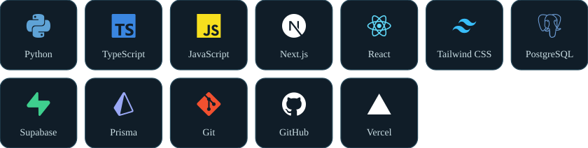

```ts
const elcan = {
  studying: "Computer Science at the Azerbaijan Technical University, Baku",
  focus: ["mathematical analysis", "linear algebra", "programming"],
  approach: "build small tools to understand each idea instead of memorizing it",
};
```

<picture>
  <source media="(prefers-color-scheme: dark)" srcset="assets/title-stack-dark.svg" />
  
</picture>



<picture>
  <source media="(prefers-color-scheme: dark)" srcset="assets/title-opensource-dark.svg" />
  
</picture>

[jev-issue-triage](https://github.com/elcann7/jev-issue-triage): a GitHub Action that labels and prioritizes new issues with TypeSafe's Jev model. Built with AI assistance (Claude Code); I design, review and test it.

<picture>
  <source media="(prefers-color-scheme: dark)" srcset="assets/title-contact-dark.svg" />
  
</picture>

[](mailto:elcanseferli666@gmail.com)
[](https://github.com/elcann7)
