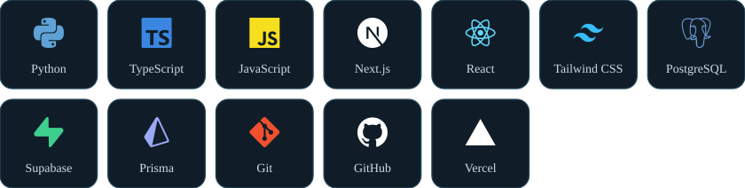

```ts
const elcan = {
  studying: "Computer Science at the Azerbaijan Technical University, Baku",
  focus: ["mathematical analysis", "linear algebra", "programming"],
  approach: "build small tools to understand each idea instead of memorizing it",
};
```

<picture>
  <source media="(prefers-color-scheme: dark)" srcset="assets/title-stack-dark.svg" />
  
</picture>



<picture>
  <source media="(prefers-color-scheme: dark)" srcset="assets/title-projects-dark.svg" />
  
</picture>

<table>
  <tr>
    <td colspan="3" valign="top">
      <h4><a href="https://github.com/elcann7/splitcast">Splitcast</a> &nbsp;·&nbsp; <a href="https://splitcast-app.vercel.app">website</a> &nbsp;·&nbsp; <a href="https://github.com/elcann7/splitcast/releases/latest/download/Splitcast-Setup.exe">download</a></h4>
      <code>TypeScript · Python · ONNX Runtime · Windows</code>
      <p>A free, open-source desktop app that cuts a film or a whole season into one scenepack per character. Local AI on NVIDIA, AMD and Intel graphics cards, nothing uploaded. One installer, 16 languages.</p>
      <a href="https://github.com/elcann7/splitcast"></a>
      <br/><b>Public · installer on GitHub Releases</b>
    </td>
  </tr>
  <tr>
    <td width="33%" valign="top">
      <h4><a href="https://github.com/elcann7/TrackYSF">TrackYSF</a></h4>
      <code>TypeScript · iOS · Android</code>
      <p>A free calorie and training tracker: AI photo food logging (bring your own Gemini key), science-based targets and personalized workout programs. Azerbaijani and English.</p>
      <b>Public · open source</b>
    </td>
    <td width="33%" valign="top">
      <h4><a href="https://github.com/elcann7/adiak-bilet">adiak-bilet</a></h4>
      <code>JavaScript · Python · Gemini</code>
      <p>A colloquium simulator: draw a ticket, answer three questions by voice and get graded out of ten by Gemini.</p>
      <b>Public</b>
    </td>
    <td width="33%" valign="top">
      <h4><a href="https://github.com/elcann7/jev-issue-triage">jev-issue-triage</a></h4>
      <code>JavaScript · GitHub Actions</code>
      <p>Labels and prioritizes new GitHub issues with TypeSafe's Jev model. Jev judges, tested code decides. Includes a local dashboard with a no-key demo.</p>
      <b>Public · MIT · CI</b>
    </td>
  </tr>
</table>

<picture>
  <source media="(prefers-color-scheme: dark)" srcset="assets/title-contact-dark.svg" />
  
</picture>

[](mailto:elcanseferli666@gmail.com)
[](https://github.com/elcann7)
