<picture>
  <source media="(prefers-color-scheme: dark)" srcset="assets/hero-dark.svg" />
  <source media="(prefers-color-scheme: light)" srcset="assets/hero-light.svg" />
  
</picture>

I study Computer Science at the **Azerbaijan Technical University** in Baku. I like problems where mathematics has to become software that actually runs, and I keep working on them until they do.

## Now

First year, working through the fundamentals properly: mathematical analysis, linear algebra, programming. I build small tools to understand each idea instead of just memorizing it. New projects land here as they are finished.

## Stack

| | |
|---|---|
| **Languages** | Python · TypeScript · JavaScript · C |
| **Web** | Next.js · React · Tailwind CSS |
| **Data** | PostgreSQL · Supabase · Prisma |
| **Tools** | Git · GitHub CLI · Vercel · Claude Code |
| **Foundations** | Mathematical analysis · discrete mathematics · data structures |

## Selected work

**[Epsilon–Delta Limit Simulator](https://github.com/elcann7/epsilon-limit-simulyasiya)** — Cauchy's definition of a limit, drawn live: epsilon corridors and delta neighborhoods on a canvas. `JavaScript · Canvas`

**Control Center** *(private)* — an ops console that aggregates health and usage from independent apps, with service-to-service bearer auth and AES-256-GCM encrypted tokens. `TypeScript · Next.js · Prisma`

 

<picture>
  <source media="(prefers-color-scheme: dark)" srcset="https://raw.githubusercontent.com/elcann7/elcann7/output/github-snake-dark.svg" />
  <source media="(prefers-color-scheme: light)" srcset="https://raw.githubusercontent.com/elcann7/elcann7/output/github-snake.svg" />
  
</picture>

## Contact

[elcanseferli666@gmail.com](mailto:elcanseferli666@gmail.com) · [github.com/elcann7](https://github.com/elcann7)
